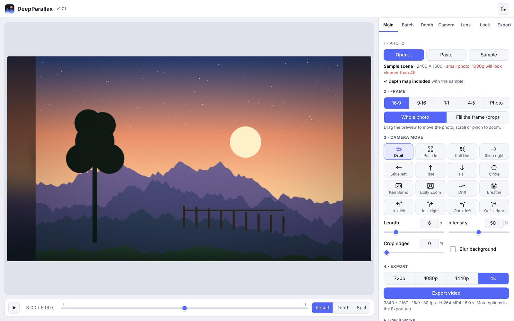

# DeepParallax

**Turn a still photo into a short 3D camera-move video, right in your web browser.**

DeepParallax uses an AI to work out what is near and what is far in a photo, then moves a virtual
camera through it. Near things slide more than far things, which is what makes the picture feel
three-dimensional (this effect is called *parallax*). It is inspired by the Final Cut Pro effects
PhotoAwake 3D and Deep Pan, but runs on its own, for free, in Safari, Edge, Chrome or Firefox.

## What it can do

- **Works out depth automatically** with the Depth Anything V2 AI, on your own device.
- **16 camera moves** at the tap of a button: orbit, push in, pull out, slides, rise and fall, circle,
  Ken Burns, dolly zoom, drift, breathe, and push or pull while turning left or right.
- **Keyframes** for custom moves, with drag-to-reorder rows.
- **Whole-photo framing:** tall photos in wide videos (and the reverse) without cropping, with a
  soft blurred surround. The photo's frame stays fixed and square while the scene moves inside it.
- **Crop** ragged scan borders, and keep the photo's edges straight.
- **Lens blur** (depth of field) with round, hexagonal or anamorphic bokeh.
- **Look:** brightness, contrast, saturation, warmth, vignette, film grain, sharpening and an
  animated light sweep.
- **Batches:** many photos at once, each with its own move and length, or shuffled at random.
  Export one video per photo (bundled in one ZIP file) or one joined video.
- **Exports MP4 video up to 4K** (H.264 or HEVC), plus still frames and depth maps as PNG.
- **Private:** photos are never uploaded. See [PRIVACY.md](PRIVACY.md).

## Getting started

**Option 1: use it online.** If this repository has GitHub Pages turned on, open
`https://<your-user-name>.github.io/deepparallax/` in your browser. That shows the launcher page
(a demo and a summary of features); click **Launch DeepParallax** to open the app. This is the best
way on iPhone and iPad.

**Option 2: use the file.** Download [`DeepParallax.html`](DeepParallax.html) and open it in your
browser. Everything except the AI files is inside that one file.

Then:

1. Click **Open…** and choose a photo (or click **Sample** to try the built-in scene).
2. Wait a few seconds while the depth map is made. The first time, about 100 MB of AI files are
   downloaded; after that they are kept on your device.
3. Pick a **camera move** and press play.
4. Choose a resolution and click **Export video**. The MP4 goes to your Downloads folder.

The full guide is in **[the manual](docs/MANUAL.md)**.

## What you need

| | Works | Notes |
|---|---|---|
| Mac: Safari, Chrome, Edge, Firefox | Yes | Safari with WebGL switched off still works, using WebGPU |
| Windows: Chrome, Edge, Firefox | Yes | |
| iPhone / iPad: Safari or Edge | Yes | Saves to Photos through the share sheet. 1080p is the practical limit. |
| Video export | Needs WebCodecs | Safari 16.4 or later, Chrome or Edge 94 or later |

A computer from the last five years or so handles 4K comfortably. Older or low-power devices are
better at 1080p.

## Licence and credits

DeepParallax is released under the **MIT licence**: see [LICENSE](LICENSE).
It includes or downloads work by others under their own licences. Most importantly:

- **mp4-muxer** (MIT) and **ONNX Runtime Web** (MIT) are included in `DeepParallax.html`.
- **Transformers.js** (Apache 2.0) and the **Depth Anything V2** models are downloaded when needed.
- The default **Standard** AI model is Apache 2.0. The optional **Detailed** model is
  **CC BY-NC 4.0, non-commercial use only**.

Full details, licence texts and credits: [THIRD_PARTY_NOTICES.md](THIRD_PARTY_NOTICES.md).

DeepParallax is an independent project and is not affiliated with FxFactory, omotion or Apple.

## Files in this repository

| File | What it is |
|---|---|
| `index.html` | The launcher page: demo video, features and a button to start the app |
| `DeepParallax.html` | The app itself (everything in one file) |
| `docs/MANUAL.md`, `docs/manual.html` | The manual (the HTML version is for reading on the website) |
| `docs/images/`, `docs/media/` | Screenshots and the demo video (made with DeepParallax from its sample scene) |
| `LICENSE`, `THIRD_PARTY_NOTICES.md`, `PRIVACY.md`, `CHANGELOG.md` | Licence, credits, privacy statement, version history |

## Version history

See [CHANGELOG.md](CHANGELOG.md). The version number is shown next to the app's name.

## Author

Douglas Alder, with code written by Claude (Anthropic).
