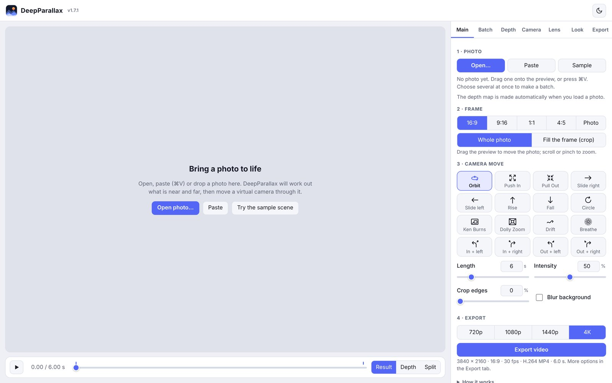
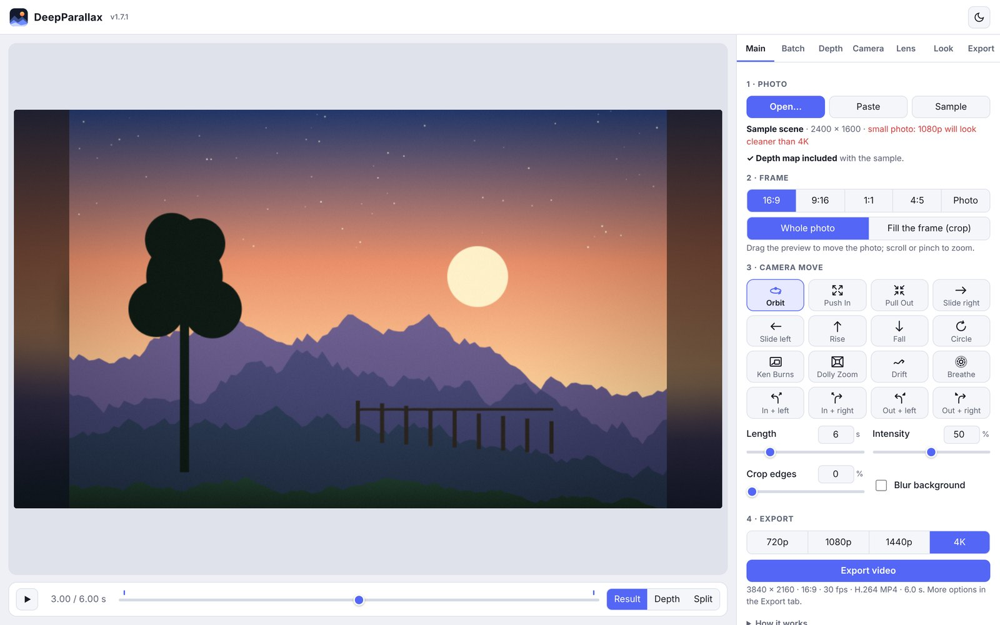
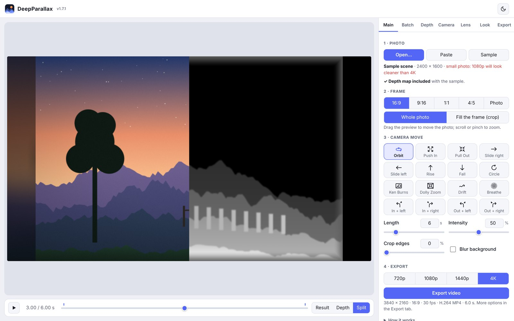
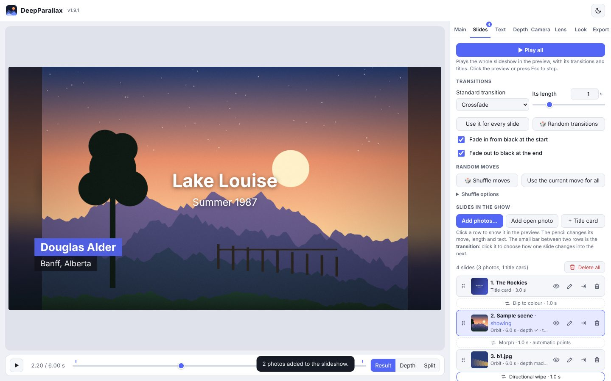
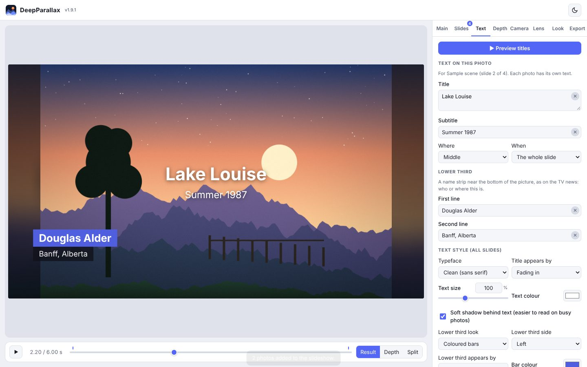
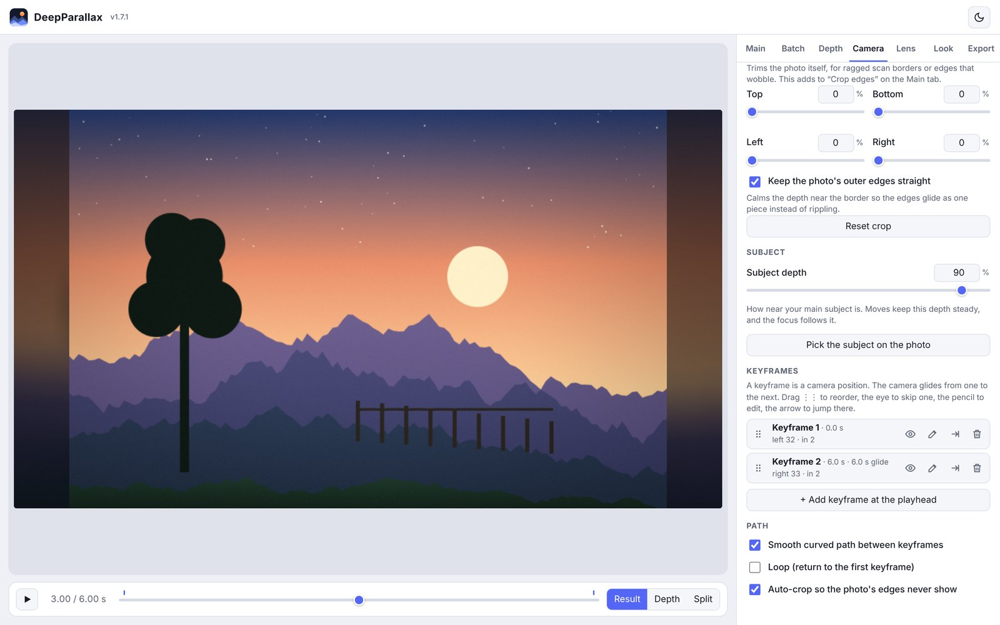
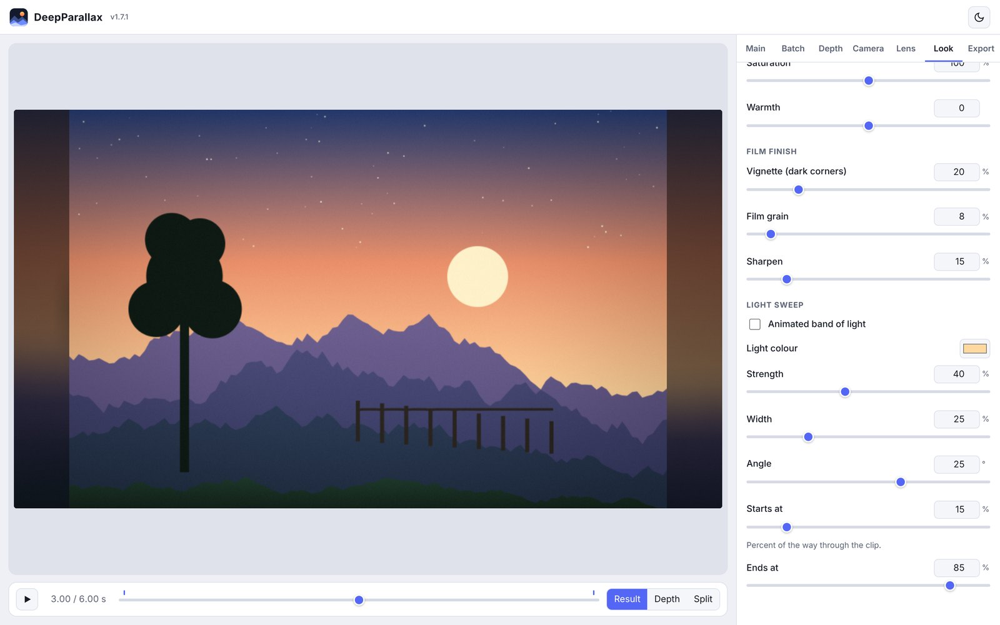
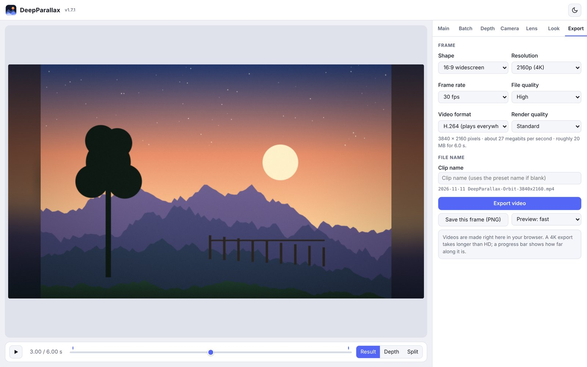
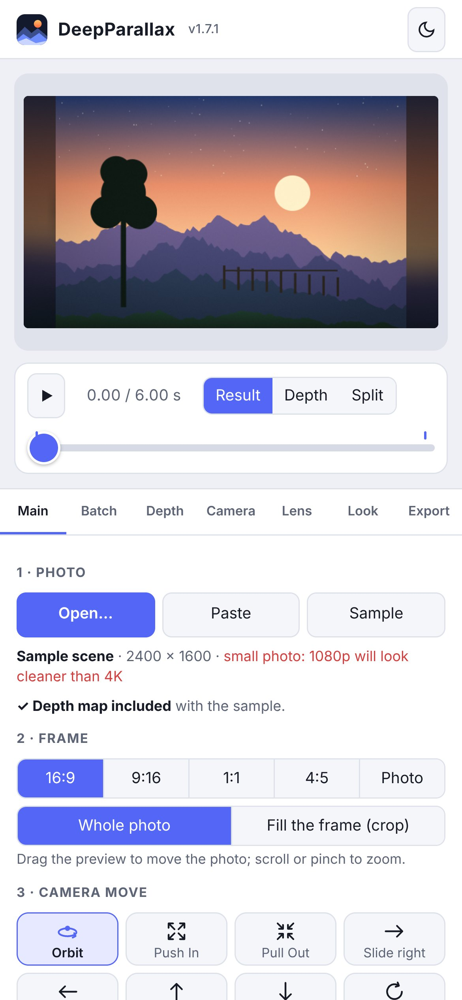

# DeepParallax manual

Version 1.9.2

This manual explains every part of DeepParallax in plain language. Technical words are explained
the first time they appear, and there is a [glossary](#18-glossary) at the end.

## Contents

1. [What DeepParallax does](#1-what-deepparallax-does)
2. [What you need](#2-what-you-need)
3. [Opening the app](#3-opening-the-app)
4. [Quick start](#4-quick-start)
5. [The screen](#5-the-screen)
6. [Main tab](#6-main-tab)
7. [Slides tab: slideshows, title cards and transitions](#7-slides-tab)
8. [Text tab: titles and lower thirds](#8-text-tab)
9. [Depth tab](#9-depth-tab)
10. [Camera tab](#10-camera-tab)
11. [Lens tab](#11-lens-tab)
12. [Look tab](#12-look-tab)
13. [Export tab](#13-export-tab)
14. [iPhone and iPad](#14-iphone-and-ipad)
15. [Tips for good results](#15-tips-for-good-results)
16. [Troubleshooting](#16-troubleshooting)
17. [Browser check and reports](#17-browser-check-and-reports)
18. [Glossary](#18-glossary)

---

## 1. What DeepParallax does

When you move your head, a fence post close to you slides past quickly while a mountain far away
hardly moves. That difference in movement is called **parallax**, and it is one of the main ways
your brain judges depth.

DeepParallax recreates it from a single still photo:

1. An AI looks at the photo and makes a **depth map**: a grey picture of the same scene where white
   means near and black means far. Nobody measured anything; the AI makes an educated guess, and it
   is usually a good one.
2. The app treats the photo as a scene with real depth and moves a virtual camera through it. Near
   parts shift more than far parts.
3. You export the result as an MP4 video, up to 4K.

Everything happens inside your web browser, on your own device. Your photos are never uploaded
([PRIVACY.md](../PRIVACY.md)).

## 2. What you need

- **A current web browser.** Safari 16.4 or later, Chrome or Edge 94 or later, or a recent Firefox.
  Safari on Mac works even if its WebGL setting is off (see [section 16](#16-troubleshooting)).
- **An internet connection the first time you make a depth map**, to download the AI files (about
  100 MB for the Standard model). After that they are kept on your device.
- **A reasonably recent computer.** Any Mac with Apple silicon (M1 or later) handles 4K well. Older
  machines and phones work, but 1080p is a better choice there.
- **Photos.** JPEG, PNG, HEIC (iPhone photos) and WebP all work. Bigger photos make sharper videos:
  for 4K output, a photo about 5,000 pixels across or more is ideal; for 1080p, about 2,500 pixels.

## 3. Opening the app

DeepParallax is a web page. There are two ways to use it.

**From a web address (recommended, especially on iPhone and iPad).** If the GitHub repository has
GitHub Pages turned on, the address looks like `https://<user-name>.github.io/deepparallax/`. It
opens the **launcher page**, which shows a demo and what the app can do. Click **Launch
DeepParallax** to open the app itself. You can add either page to your iPhone or iPad home screen
with **Share → Add to Home Screen**.

**From the file.** Download `DeepParallax.html` from the repository and double-click it. It opens in
your default browser. To choose a different browser on a Mac, right-click the file and choose
**Open With**. (The launcher page, `index.html`, is only an introduction; the app is all in
`DeepParallax.html`.)

The version number is shown in small type next to the app's name, for example **v1.9.2**.

## 4. Quick start

1. Click **Open…** (or **Paste**, or drag a photo onto the preview).
   To try things without a photo of your own, click **Sample**.
2. Wait for **✓ Depth map ready**. The first time, a progress bar shows the AI download.
3. Click a **camera move** button. The preview starts playing.
4. Adjust **Length** (seconds) and **Intensity** (how strong the movement is).
5. Pick a resolution (**720p**, **1080p**, **1440p** or **4K**) and click **Export video**.

The video is saved to your Downloads folder with a name like
`2026-11-11 DeepParallax-Orbit-3840x2160.mp4`: the date, the app, the move (or your clip name) and the
size in pixels.

## 5. The screen

- **Preview (left).** Shows the result. **Drag** on it to move the photo within the frame;
  **scroll** or **pinch** on it to zoom. Click it to play or pause.
- **Timeline (below the preview).** The play button, the time, and a slider you can drag to any
  moment. Small blue marks show where the keyframes are (see [section 10](#10-camera-tab)).
- **Result / Depth / Split.** *Result* shows the finished look. *Depth* shows the depth map. *Split*
  shows the result on the left and the depth map on the right, so you can check the AI's guesses.
- **Tabs (right).** Main, Slides, Text, Depth, Camera, Lens, Look and Export. Everything you need for a
  normal video is on **Main**; the other tabs are for fine-tuning.
- **Light / dark button** (top right) switches the colour scheme.

On a phone or a narrow window, the tabs move below the preview.

## 6. Main tab

The Main tab has the essentials, top to bottom.

**1 · Photo**
- **Open…** chooses a photo. Choose several at once to start a slideshow ([section 7](#7-slides-tab)).
- **Paste** uses an image you've copied. **⌘V** (Ctrl+V on Windows) also works anywhere in the app.
- **Sample** loads a built-in landscape that already has a depth map.
- Below the buttons: the photo's name and size, and the depth map's status, with a button to make
  it again.

If you open a picture with a transparent background (a PNG cut-out, for example), DeepParallax trims
away the empty space, leaving a 24-pixel margin, and puts it on the fill colour chosen in the Depth
tab.

**2 · Frame**
- **Shape**: 16:9 (widescreen, like YouTube), 9:16 (vertical, like Reels and TikTok), 1:1 (square),
  4:5 (portrait, Instagram feed) or **Photo** (the photo's own shape).
- **Whole photo** shows the entire photo. If the photo's shape doesn't match the frame, the space
  around it is filled with a soft, darkened, blurred copy of the photo (or a plain colour, set in the
  Camera tab). The photo's edges stay fixed and square; the camera move happens inside them.
- **Fill the frame (crop)** enlarges the photo until it fills the frame, cutting off whatever
  doesn't fit. Drag the preview to choose which part shows.

**3 · Camera move**

Sixteen buttons, each with an arrow or picture showing the movement:

| Move | What the camera does |
|---|---|
| Orbit | Swings sideways around your subject; the background moves the opposite way. |
| Push In | Moves gently forward into the scene. |
| Pull Out | Starts close and moves back. |
| Slide right / Slide left | Moves sideways while the far background stays still. |
| Rise / Fall | Moves up or down, like a camera crane. |
| Circle | Travels in a slow loop and returns to the start (good for repeating clips). |
| Ken Burns | The classic slow zoom with a slight drift, named after the documentary maker. |
| Dolly Zoom | Moves in while zooming out, so the subject stays the same size but the background stretches (the "Vertigo" effect). |
| Drift | A slow, gentle sideways float. |
| Breathe | A tiny push in and back out, over and over. |
| In + left / In + right | Pushes in while swinging around the subject, with a slight tilt into the turn. |
| Out + left / Out + right | The same, while pulling back. |

- **Length** is the clip's duration in seconds (1 to 30).
- **Intensity** is how far the camera moves (0 to 100%). Start around 50%. High values show more
  3D but also more stretching at edges.
- **Crop edges** trims the same percentage off all four sides of the photo, for example to remove a
  ragged scan border.
- **Blur background** turns on depth of field ([section 11](#11-lens-tab)).

**4 · Export**: pick the resolution and click **Export video**. The line underneath summarises the
size, shape, frame rate and format. More options are in the Export tab.

At the bottom of the Main tab:
- **How it works**: a short reminder.
- **About and licences**: credits and licence summary.
- **Browser check**: what your browser supports ([section 17](#17-browser-check-and-reports)).

## 7. Slides tab

The Slides tab turns several photos into a **slideshow**: one video in which each photo plays its
camera move, then changes into the next with a **transition** (a dissolve, a wipe, a morph and so
on). You can also put plain **title cards** (words on a coloured background) anywhere in the show.
The number on the tab shows how many slides there are.

(In versions before 1.8 this was called the Batch tab. It still does everything the Batch tab did,
including one video per photo.)

**The order of the tab, top to bottom:** ▶ Play all, Transitions, Random moves, the list of
slides, Soundtrack, then Export.

**▶ Play all** plays the whole slideshow in the preview, live, with its transitions, titles and the
fade in and out. The timeline under the preview shows where it is. To stop, click the button again
(it says **■ Stop** while playing), click the preview, or press Esc or the space bar.
- Before it starts, any depth maps that haven't been made yet are made, which can take a moment.
- Live playback is drawn at preview size with slightly simpler 3D, so it is a little softer than the
  exported video. If the computer can't keep up, playback slows down rather than skipping parts.
- In backup mode (when the browser's graphics chip is switched off), live playback isn't possible.
  Use **▶ Quick preview** at the bottom of the tab instead: it makes a small video and plays it.

**Adding slides**
- **Add photos…** chooses one or more photos.
- **Open…** on the Main tab with several photos selected also creates (or adds to) the slideshow.
- **Add open photo** puts the photo you're working on into the slideshow.
- **+ Title card** adds a card straight after the slide that's showing (or at the end). Its editing
  panel opens so you can type the words. Drag it by its handle to put it somewhere else.

**The rows.** Each slide has a row with a small picture, its name, and a summary: the camera move,
the length, whether its depth map is ready, and whether it has a title or lower third. **Click a
row** to show that slide in the preview; it is marked *showing*. The icons, left to right:

| Icon | What it does |
|---|---|
| ⋮⋮ (drag handle) | Drag up or down to change the order. |
| Eye | Include or leave out of the export. A crossed-out eye means it will be skipped. |
| Pencil / tick | Opens a panel under the row. For a photo: its move, length, intensity, title, subtitle and lower third. For a title card: its words, length and background. Tap the tick to close it. |
| Arrow | Shows the slide in the preview (same as clicking the row). |
| Bin | Removes the slide (not the photo on your computer). If it was showing, the next one is shown. |

**Each photo remembers its own** camera move, length, intensity, crop, framing, subject depth,
custom keyframes, depth map, text and transition. **These apply to every slide:** frame shape,
resolution, frame rate, text style, and the Lens and Look settings.

To fine-tune one photo, click its row, then use the other tabs as normal. Your changes are kept with
that photo.

**Title cards**

A title card is a plain background with a title and an optional subtitle, for example an opening
title, a chapter heading ("Day 2: Jasper") or a closing "The End". Each card has:
- **Title** and **Subtitle**. Press Return in the title box to start a second line.
- **Length**, 1 to 30 seconds.
- **Background**: *One colour*, a *Gradient* (colour 1 in the top-left corner fading to colour 2 in
  the bottom-right) or a *Glow from the middle* (colour 2 in the centre fading out to colour 1).

The words fade in and out by themselves, and use the text style from the Text tab.

**Transitions**

Between every two rows there is a thin bar showing the transition, for example
*Crossfade · 1.0 s*. It controls how that slide changes into the **next** one. Click the bar to open
its settings:

| Transition | What it looks like |
|---|---|
| Cut | No transition: the next slide simply starts. |
| Crossfade | The first picture dissolves smoothly into the second. |
| Fade through black | The first picture fades to black, then the second fades up. |
| Dip to colour | The same, through a colour you choose (white is popular). |
| Cross-blur | The first picture goes soft and blurry, turns into the second, which sharpens up. |
| Cross zoom | A fast zoom with motion blur from one picture into the next. |
| Directional wipe | A soft-edged line sweeps across, revealing the next picture. |
| Push | The next picture pushes the first one out of the frame. |
| Slide over | The next picture slides in on top of the first. |
| Iris | A circle opens from the middle, revealing the next picture. |
| Star wipe | A spinning star grows from the middle (a deliberately old-fashioned TV effect). |
| Clock wipe | A line sweeps around like a clock hand. |
| Morph | One picture melts into the other, with matching features gliding onto each other (see below). |

Depending on the transition, you can also set its **Length** (0.2 to 4 seconds), the **Direction**,
the **Soft edge**, the **Amount** of blur or zoom, the **Colour** to dip to, or the number of **Star
points**. Two buttons sit underneath:
- **▶ Preview this transition** makes a short, low-resolution video of just that moment (about one
  second before and after) and plays it in a box on screen.
- **Use for every slide** copies this transition to every slide.

During most transitions both slides keep moving: the next slide's camera move has already started
while the first one finishes. That is why a slideshow is a little shorter than its slides added up.
A transition can't be longer than half of either slide it joins; DeepParallax shortens it if
needed.

Under **Transitions** further down the tab:
- **Standard transition** and **Its length** are used for new slides.
- **Use it for every slide** applies them to all the slides you already have.
- **🎲 Random transitions** gives every slide a random transition (never the same one twice in a
  row), and a random direction where that applies. It doesn't choose Morph, which needs points.
- **Fade in from black at the start** and **Fade out to black at the end** (both on at first) give
  the whole slideshow a gentle beginning and end.

**Random moves**
- **🎲 Shuffle moves** gives every included photo a random camera move.
- **Use the current move for all** copies the move, length and intensity of the photo you're working
  on to every photo.
- Under **Shuffle options**: **Never the same move twice in a row** (on at first) avoids repeats
  next to each other, and **Also vary the lengths when shuffling** picks a random length between
  **Shortest** and **Longest**.

**The morph transition**

The morph is based on the author's **Morph Lab** project. It works like the morphs in old music
videos where one face turns into another: matching points on the two pictures are pulled onto each
other while one picture dissolves into the other.

*Automatic points.* With **Place points automatically** ticked (the default), DeepParallax looks at
the depth view of both pictures and does two things:
- It finds the **near layer**: the nearest shape that stands out from what is around it, such as a
  tree, a person, a rock or a creature. (The ground is usually left out, because it slopes gently
  towards the camera and is no nearer than the rest of its row.) It then follows that shape's edge
  all the way round, the way you would place points by hand in Morph Lab, and puts 28 points evenly
  along it, numbered in order. The same is done on the second picture, and the numbering is turned
  so that point 1 meets the point that matches it best; after that, 2 goes to 2, 3 to 3 and so on.
  If the middle of the shape is inside both shapes, one more point goes there. Points that would sit
  on the edge of the frame are left out, because they would tear it.
- It finds the **horizon**: the line where the middle distance meets the sky, and places up to six
  points along it, so hills and skylines glide into each other.

The points are worked out the first time the morph is needed (in the point editor, Play all, a
preview or an export), and again only if either slide's camera move, length or framing changes.
Pictures with no clear depth, and title cards, get no automatic points; the morph is then a plain
dissolve, plus any points you add.

*Background follows by* (0 to 100%, 30% at first) sets how far the background trails behind the
near layer. At 0% everything moves and dissolves together. Higher values let the near layer move
and dissolve first, with the background catching up a moment later, which looks more fluid,
something like the layers of a pop-up book settling one after another.

*Adjusting the points by hand:*

1. Choose **Morph (matching points)** for a transition, then click **See and adjust the points…**.
   DeepParallax draws the last frame of this slide and the first frame of the next, side by side.
   The dots are coloured: **orange** for the near layer and **teal** for the horizon (both
   automatic), and **blue** for your own.
2. Click a feature on either picture, such as the corner of an eye. A numbered dot appears in the
   same place on **both** pictures.
3. Drag the dot on the other picture onto the **same** feature there. Dot 1 on the left and dot 1
   on the right are a pair.
4. Repeat for other features: eyes, nose, mouth and chin for faces; rooftops, horizons and tree
   tops for landscapes. Five to twenty pairs is usually plenty.
5. Drag the **Try the morph** slider (or type a percentage in its box) to watch the in-between
   pictures, and the **Background follows by** slider to try different delays. Drag any dot that
   makes things smear. A dot you drag turns blue: it is yours now and is kept if the automatic points
   are worked out again.
6. Click **Done**.

To remove a pair, click one of its dots (it turns yellow) and click **Delete selected pair**, or press
Delete on the keyboard. **Delete all pairs** starts again. **✨ Redo automatic points** finds the
near layer and horizon again and replaces the orange and teal dots, keeping your blue ones. With no pairs at all, the morph is a plain
dissolve.

How it works, briefly: DeepParallax joins the dots (plus the corners and edge midpoints of the frame)
into a mesh of triangles. During the morph, every triangle moves from its place in the first
picture to its place in the second, stretching the picture inside it, while the two pictures
dissolve into each other. With *Background follows by* above 0%, the near layer's points move ahead
of the rest, and a soft-edged mask shaped like the near layer lets it dissolve sooner than the
background. Unlike the other transitions, a morph holds both slides still while it
happens (the moving camera would pull the features away from their dots), so it adds its length to
the slideshow.

**Soundtrack**

You can add one piece of music to the slideshow.
- **♪ Add music…** chooses a sound file. MP3, M4A (AAC), WAV and AIFF work in every browser. You can
  also drag a music file onto the preview or onto the side panel.
- The box below shows the file's name and length. The bin icon removes it (your file is untouched).
- **▶ Listen** plays the first 20 seconds with your volume and fades. Click again to stop.
- **Volume** (0 to 150%). Above 100% makes quiet music louder, but very loud music may distort.
- **Start song at** skips into the song, for example to start at the chorus.
- **Fade in** and **Fade out** (0 to 15 seconds). The fade out always ends exactly when the video
  ends, or where the music runs out if it is shorter than the video and not repeated.
- **Repeat the music if it is shorter than the video** (on at first) starts the song again from the
  beginning until the video ends.

The music is used in the **slideshow video**, the **video made on the Main tab**, **Play all** and
**Quick preview**. It isn't added to *One video per slide* or to transition previews.

The sound is saved inside the MP4 as **AAC**, the standard sound format for MP4 files, which plays
everywhere. Browsers that can't make AAC (Chrome on Linux, for example) use **Opus** instead, which
plays in Chrome, Edge, Firefox and VLC but not in QuickTime. A browser that can't encode sound at all
says so and makes a silent video. *Browser check* on the Main tab shows which applies to yours.

**Exporting**
- **One slideshow video** (the default) joins every included slide into a single MP4 with the
  transitions, for example `2026-11-20 DeepParallax-Slideshow of 12-1920x1080.mp4`. Every slide
  must share one frame shape, so if **Photo** shape is chosen, 16:9 is used instead.
- **One video per slide** makes a separate MP4 for each slide, named after the photo (title cards
  are named *Title card 3* and so on). Transitions are not used. With **Put the videos in one ZIP
  file** ticked (the default), they arrive as a single download. A ZIP file is a bundle of files;
  Safari usually unpacks it into a folder automatically, otherwise double-click it.
- **▶ Quick preview** makes a small, rough version of the whole slideshow (360 pixels high, simple
  3D) and plays it on screen, so you can check the timing before a long export.
- **Export slideshow** starts. The progress box shows how far along it is. Depth maps that don't
  exist yet are made along the way. **Cancel** stops after the current frame.
- **Delete all** (above the list) removes every slide and clears the preview. Your original files
  are not touched.

If you click **Export slideshow** while the list is empty but a photo is open, that photo is added
and exported.

## 8. Text tab

The Text tab adds words on top of the moving picture. The top half is for **the slide that's
showing**; the bottom half is the **style for every slide**.

**▶ Preview titles** (at the top of the tab) plays the slide that's showing from the start, so you
can see its title and lower third come in and go out with their real timing. On a title card it
plays the card.

**On a photo**
- **Title** and **Subtitle**: big words with a smaller line under them. Press Return in the title
  box for a second line.
- **Where**: the middle, top or bottom of the picture.
- **When**: the whole slide, only the first 3 seconds, or only the last 3 seconds. Text always fades
  (or rises) in and out smoothly.
- **Lower third**: a name strip near the bottom of the picture, as on the TV news ("lower third"
  because it sits in the bottom third of the screen). Use the **first line** for a name or place and
  the **second line** for a date or description. It slides or fades in shortly after the slide
  starts and leaves shortly before it ends.

The same boxes are in each photo's row panel on the Slides tab, so you can type the text for many
photos without clicking between them. Every text box has a small **✕** on the right to clear it.

**On a title card** the top half shows the card's words, length and background instead.

**Text style (all slides)**
- **Typeface**: Clean, Classic, Elegant, Friendly, Geometric or Typewriter. These use fonts that are
  already on Macs, iPhones and iPads, so nothing is downloaded. Other computers use the nearest
  similar font.
- **Title appears by** fading in, rising while fading in, or just appearing.
- **Text size** (40 to 200%) and **Text colour**.
- **Soft shadow behind text**: makes words easier to read on busy or bright photos.
- **Lower third look**: *Coloured bars* (a coloured strip for the first line and a dark strip for
  the second), a *Dark box* with a coloured edge, or *Words only*. Choose its **side** (left or right),
  how it **appears** (sliding or fading in) and the **bar colour**.

Text is drawn at the full export size on top of the finished 3D picture, so it is always sharp and
never wobbles with the camera move. The preview shows it too.

## 9. Depth tab

**Making the depth map**
- **Generate depth map with AI** makes (or remakes) it.
- **AI model**: **Standard** (about 100 MB; good for most photos; free for any use) or **Detailed**
  (about 390 MB; slower; sometimes finer edges; **licensed for non-commercial use only**, see
  [THIRD_PARTY_NOTICES.md](../THIRD_PARTY_NOTICES.md)).
- **Detail**: Fast, Normal or High. Higher looks at the photo in more detail but takes longer and
  uses more memory.
- **Run the AI on**: *Automatic* uses the graphics chip when possible. *Main processor* is slower
  but works everywhere; try it if the AI fails.
- **Make a depth map automatically when a photo loads**: on by default.
- The small grey picture is the current depth map (white = near).

**AI files (one time only).** Some browsers, such as Edge on iPhone and iPad opening a page from the
Files app, won't let a page download the AI files itself. If that happens, this box appears (you can
also open it with the link **AI not working? Add the AI files by hand**):

1. Tap the two links to download the **AI engine** (`ort-wasm-simd.wasm`, 10 MB) and the **AI
   model** (`model.onnx`, 99 MB). These are ordinary downloads, which every browser allows.
2. Tap **Choose the AI files…** and pick both files.

The app keeps them, so you only do this once per browser.

**Adjusting the depth**
- **3D amount**: how far apart near and far are. More gives stronger 3D, but more stretching.
- **Edge protection**: grows near objects very slightly, so that the stretching that happens behind a
  subject's edge falls on the background, not on the subject.
- **Smoothing**: softens the depth map. Hides small AI mistakes at the cost of detail.
- **Near / far balance**: positive values bring more of the picture forward; negative push it back.
- **Invert**: swaps near and far, in case the AI got it backwards (rare).
- **Load depth image…** uses a depth map from another app (white = near).
- **Save depth map** saves the current one as a PNG picture.

**Transparent images**: the fill colour used behind transparent PNGs.

## 10. Camera tab

**Framing**
- **Frame zoom** enlarges or shrinks the photo within the frame (50 to 300%).
- **Position left / right** and **down / up** move it. Dragging the preview does the same.
- **Around the photo**: a blurred copy of the photo, or a solid colour you choose.
- **Reset framing** puts everything back.

**Crop** trims the photo itself: **Top**, **Bottom**, **Left** and **Right**, each up to 40%. These
add to *Crop edges* on the Main tab. Changing the crop doesn't re-run the AI.
**Keep the photo's outer edges straight** (on by default) calms the depth near the border so the
edges glide as one piece instead of rippling.

**Subject**
- **Subject depth** says how near your main subject is. Camera moves keep this depth steady, and the
  focus follows it. The app guesses it automatically.
- **Pick the subject on the photo**: click the button, then click your subject in the preview.

**Keyframes.** A keyframe is a saved camera position. The camera glides from one keyframe to the
next. The preset moves are made of keyframes, and you can change them. Each keyframe is a row:

| Icon | What it does |
|---|---|
| ⋮⋮ | Drag to change the order. |
| Eye | Skip or include this keyframe. |
| Pencil / tick | Edit the keyframe's values; tap the tick (or **Done**) to confirm. |
| Arrow | Jump the preview to this keyframe. |
| Bin | Delete it. |

While editing a keyframe, the preview shows your changes live:
- **Left / right**, **Down / up**: camera position.
- **Move in / out**: moves the camera physically forward or back (true perspective change).
- **Lens zoom**: zooms like a lens, without changing perspective.
- **Tilt (roll)**: tilts the picture inside the frame.
- **Steady depth**: which depth stays still while the camera moves (0 = background, 100 = nearest).
- **Focus depth**: used for blur when *Focus follows subject* is off.
- **Travel time**: seconds to glide here from the previous keyframe.
- **Easing**: how the movement starts and stops (gentle, constant speed, and so on).

**+ Add keyframe at the playhead** adds a new keyframe where the timeline slider is.

Once you change keyframes by hand, the Main tab's move buttons are no longer highlighted
("custom move"). Clicking a move button starts fresh from that preset.

**Path**
- **Smooth curved path between keyframes**: glides along a curve instead of straight lines.
- **Loop**: returns to the first keyframe at the end, for seamless repeating clips.
- **Auto-crop so the photo's edges never show**: zooms in just enough that the moving picture never
  shows an empty strip. Leave this on unless you want to see exactly what happens at the edges.

## 11. Lens tab

**Depth of field** blurs things that are nearer or farther than the focus point, like a real camera
lens with a wide aperture.
- **Blur the background**: on or off (same as on the Main tab).
- **Blur amount**: how strong the blur is.
- **Focus follows the subject**: keeps focus on the subject depth.
- **Pick the focus point on the photo**: click the button, then click the spot in the preview.
- **Bokeh shape**: "bokeh" is the shape that out-of-focus lights take. **Round**, **Hexagon** (like a
  six-bladed lens) or **Anamorphic** (tall ovals, the cinema look).
- **Highlight glow**: makes bright spots bloom into visible bokeh shapes.

## 12. Look tab

- **Reset all Look settings** returns everything on this tab to its starting values.
- **Colour**: Brightness, Contrast, Saturation (colour strength), Warmth (orange versus blue).
- **Film finish**: Vignette (darker corners), Film grain, Sharpen.
- **Light sweep**: an animated band of light that crosses the picture. Choose its colour, strength,
  width and angle, and when it starts and ends (as a percentage of the clip).

## 13. Export tab

- **Shape** and **Resolution**: the same as on the Main tab. Resolution is the shorter side in
  pixels: 720p is 1280 × 720 for widescreen, 1080p is HD (1920 × 1080), 4K is 3840 × 2160.
- **Frame rate**: frames per second (fps). 24 looks like film, 25 is the European TV standard, 30 is
  common for online video, 60 is extra smooth.
- **File quality**: how much data per second the video uses. Higher looks better and makes bigger
  files. The estimated size is shown underneath.
- **Video format**: **H.264** plays everywhere. **HEVC** (also called H.265) makes smaller files
  with the same quality; it plays on Apple devices and most modern computers. If your browser can't
  make the chosen format at that size, the other one is used and a message says so.
- **Render quality**: *Best* calculates each frame more carefully, which helps with strong camera
  moves and blur, but takes longer.
- **Clip name**: used in the file name instead of the move's name. The ✕ clears it. The full file
  name is previewed below the box.
- **Export video**: same as on the Main tab.
- **Save this frame (PNG)**: saves the current preview frame as a full-resolution picture.
- **Preview: fast / sharp**: the preview's own quality. It doesn't affect the exported video.

**How long does exporting take?** It depends on the computer, the resolution and the settings. On a
recent Mac, a 6-second 1080p clip usually takes seconds, and 4K takes a few times longer. The
progress box shows an estimate of the time left. In backup mode (see below) it's much slower.

## 14. iPhone and iPad

- **Opening the app**: from a web address (GitHub Pages) is easiest. Opening the file from the Files
  app also works in Edge.
- **The first depth map** downloads about 100 MB. If the browser blocks it, use the *AI files*
  box ([section 9](#9-depth-tab)). Making a depth map on a phone can take 10 to 30 seconds.
- **Saving videos**: when an export finishes, a box appears. Tap **Save to Photos / Share…**, then
  **Save Video** (or **Save 3 Videos** when there are several). The file names in the box are download links, as
  a backup. iOS only lets a page save a file straight after a tap, which is why this extra step is
  needed.
- **Recommended size**: 1080p. 4K may run out of memory on some devices, especially for slideshows,
  which hold two photos at once during each transition. The app shows a tip when you export larger
  than 1080p on an iPhone or iPad.
- **"Canvas has no frame"** (versions before 1.8.0): this export error on iPad is fixed in 1.8.0. If
  an iPad export still fails, try 1080p.
- On touch screens, sliders get bigger thumbs, and number boxes use larger text so iOS doesn't zoom
  in when you tap them.

## 15. Tips for good results

- **Clear subjects work best**: a person, animal or object in front of a background. Busy scenes,
  fine hair, fences, glass and reflections confuse the AI more.
- **Use Split view** to check the depth map. If something is wrong, try Smoothing, Edge protection,
  or the Detailed model.
- **Less is more.** Intensity around 30 to 60% and lengths of 5 to 8 seconds look natural. Big
  moves reveal the "stretched" areas behind objects, which a single photo can't fill in.
- **Pick the subject** (Camera tab) so the move pivots around what matters.
- **Use photos larger than your video.** A small photo at 4K looks soft; the app warns you when a
  photo is small.
- **Old scanned photos**: use *Crop edges* to remove ragged borders.

## 16. Troubleshooting

| Problem | What to do |
|---|---|
| A red message appears at the top | Read it; it usually says what to do. Click it to close it. If it keeps happening, copy the report (see [section 17](#17-browser-check-and-reports)). |
| "The AI could not run" | Check your internet connection the first time. Try *Run the AI on: Main processor*. On iPhone or iPad, use the *AI files* box. Or load a depth map image. |
| "Backup mode" note on the Main tab | The browser's 3D graphics (WebGL and WebGPU) are both unavailable, so the main processor does the drawing. Everything works, more slowly. Exports at 1080p are about four times faster than 4K. |
| Safari says WebGL is off | DeepParallax uses WebGPU instead, automatically. If neither works: quit Safari completely (⌘Q) and reopen it; check that Lockdown Mode is off (System Settings › Privacy & Security); in Safari › Settings › Advanced, tick "Show features for web developers", then check Develop › Feature Flags for WebGL. |
| Export seems stuck | Wait a minute: the first frames of a 4K export can be slow. If it truly stops, an error message appears after a while. Try 1080p or the other video format. |
| The video looks soft | Use a larger photo, a lower resolution, or reduce Frame zoom and Intensity. |
| Edges of objects look stretched | Lower Intensity or 3D amount, raise Edge protection, or choose a gentler move. |
| An export on iPhone or iPad fails, or mentions memory or frames | Use 1080p. Close other apps and browser tabs, then try again. |
| A transition looks too fast or slow | Click its bar between the rows on the Slides tab and change its Length. A transition can't be longer than half of either slide it joins. |
| The morph smears or tears | Open *See and adjust the points…* and drag the dots near the tear onto matching features, or add pairs there. Very different pictures (one zoomed far in, a subject cut off by the edge) smear most. Lowering *Background follows by* also helps. |
| A video made in Safari has no sound (versions 1.9.1 and earlier) | Fixed in 1.9.2. Export again. |
| The slideshow flashes a grey, cloudy picture (the depth view) in Safari (1.9.1 and earlier) | Fixed in 1.9.2. Export again. |
| Play all is jerky | Live playback depends on the graphics chip. Close other tabs, or use *▶ Quick preview*, which makes a small video and plays it smoothly. |
| Several downloads on Safari | Tick *Put the videos in one ZIP file* on the Slides tab. |
| The page is zoomed in on iPhone | Pinch to zoom out once. Version 1.6.1 and later stop this happening. |

## 17. Browser check and reports

At the bottom of the Main tab, **Browser check** lists what your browser supports:

- **Graphics chip drawing**: WebGL, WebGPU, or "backup mode".
- **Video export (HD / 4K)**: whether the browser can make MP4 video at those sizes.
- **AI on graphics chip (WebGPU)**: whether the AI can use the graphics chip.
- **Keeps AI model between visits**: whether the downloaded AI files can be kept.
- **Browser**: which browser was detected.

**Copy a report** puts a short technical log on your clipboard (no photos). If you ask for help,
paste it into your message; it shows what the app did, step by step.

## 18. Glossary

- **Anamorphic**: a type of cinema lens that makes out-of-focus lights look like tall ovals.
- **Bokeh**: the look of the out-of-focus parts of a picture, especially the shape of blurred lights.
- **Codec**: the method used to compress video. H.264 and HEVC are codecs.
- **Depth map**: a grey picture of the scene where brightness means distance (white = near).
- **Depth of field**: the range of distances that look sharp; everything else is blurred.
- **Easing**: how a movement speeds up and slows down.
- **fps (frames per second)**: how many still pictures make one second of video.
- **H.264 / HEVC (H.265)**: common video formats. H.264 plays everywhere; HEVC makes smaller files.
- **Keyframe**: a saved camera position the camera moves through.
- **Lower third**: a strip with a name or place near the bottom of the picture, as on the TV news.
- **Morph**: a transition where one picture melts into another while matching features glide onto
  each other.
- **MP4**: the standard video file type, which almost every device can play.
- **Parallax**: near things appearing to move more than far things when the viewpoint moves.
- **PNG**: a picture file type that keeps full quality.
- **Resolution**: the size of the video in pixels, such as 1920 × 1080.
- **Title card**: a slide with words on a plain or shaded background, and no photo.
- **Transition**: the way one slide changes into the next, such as a dissolve or a wipe.
- **WebCodecs**: the part of a browser that turns frames into compressed video.
- **WebGL / WebGPU**: two ways a web page can use the computer's graphics chip. WebGPU is newer.
- **ZIP file**: a single file that bundles several files together.
- **AAC / Opus**: formats for compressed sound. AAC is the usual sound format inside MP4 videos.

---

DeepParallax is released under the MIT licence. See [LICENSE](../LICENSE),
[THIRD_PARTY_NOTICES.md](../THIRD_PARTY_NOTICES.md) and [PRIVACY.md](../PRIVACY.md).
