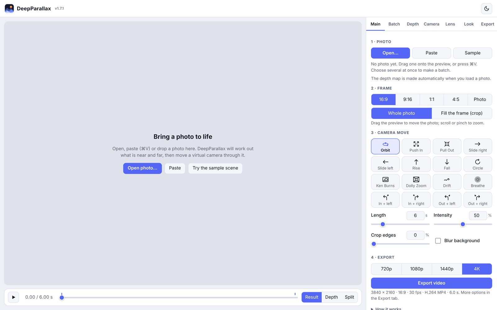
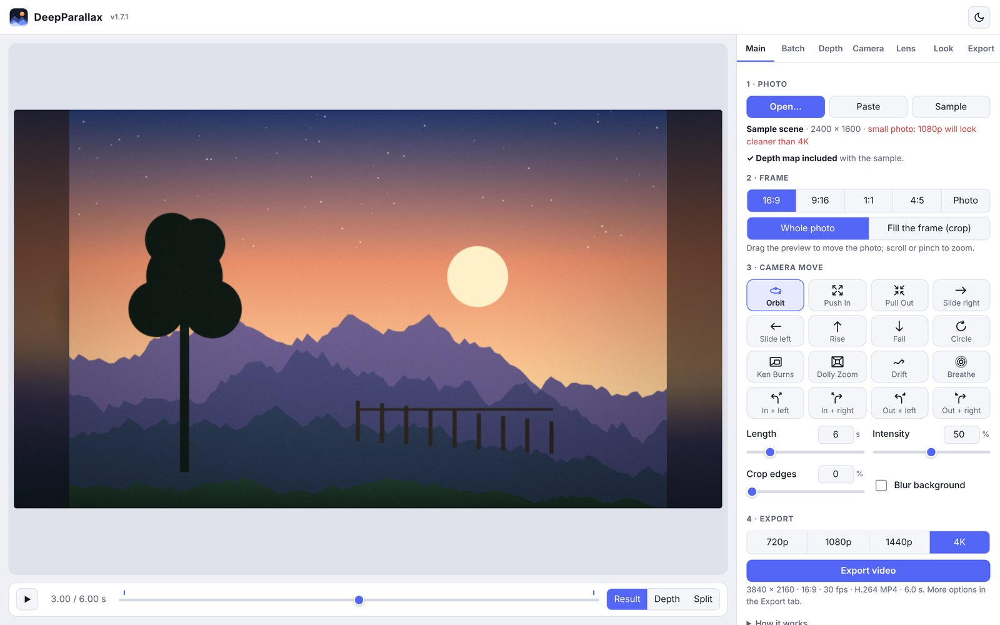
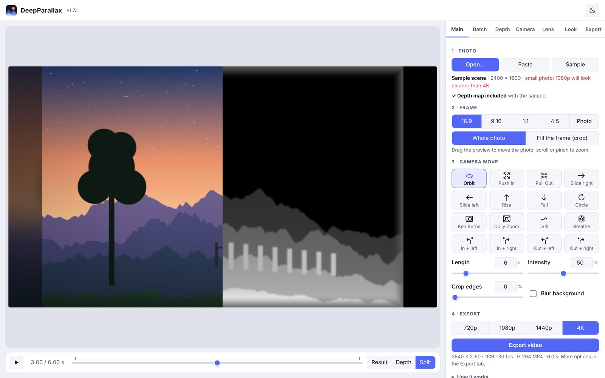
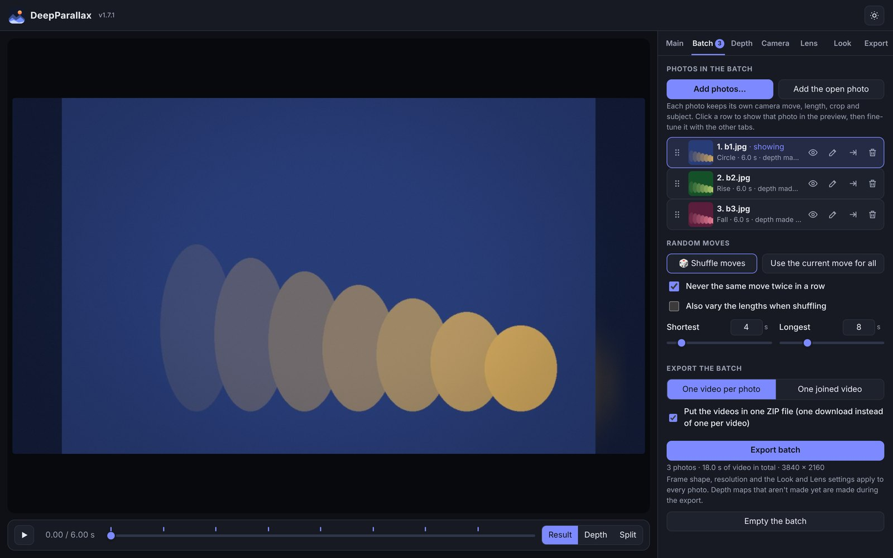
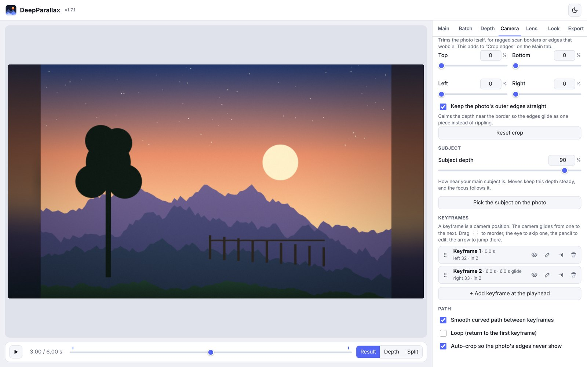
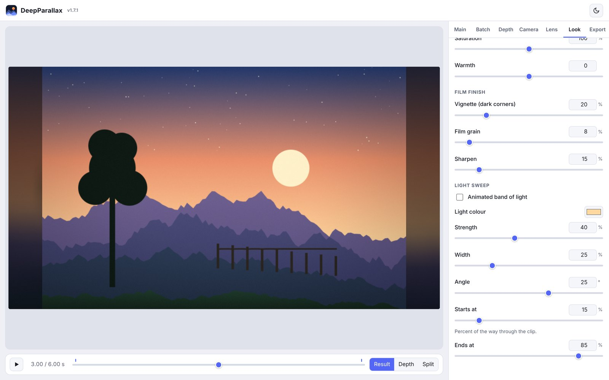
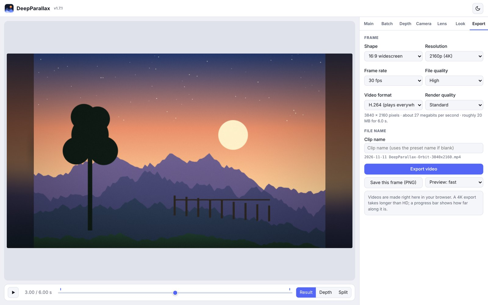
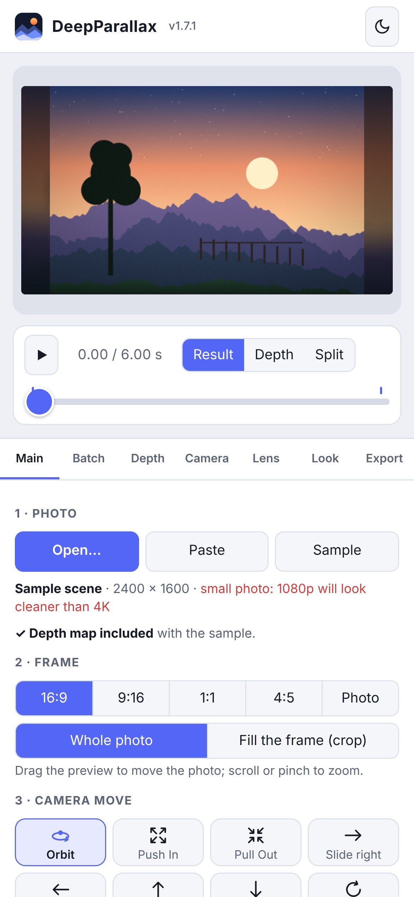

# DeepParallax manual

Version 1.7.1

This manual explains every part of DeepParallax in plain language. Technical words are explained
the first time they appear, and there is a [glossary](#17-glossary) at the end.

## Contents

1. [What DeepParallax does](#1-what-deepparallax-does)
2. [What you need](#2-what-you-need)
3. [Opening the app](#3-opening-the-app)
4. [Quick start](#4-quick-start)
5. [The screen](#5-the-screen)
6. [Main tab](#6-main-tab)
7. [Batch tab](#7-batch-tab)
8. [Depth tab](#8-depth-tab)
9. [Camera tab](#9-camera-tab)
10. [Lens tab](#10-lens-tab)
11. [Look tab](#11-look-tab)
12. [Export tab](#12-export-tab)
13. [iPhone and iPad](#13-iphone-and-ipad)
14. [Tips for good results](#14-tips-for-good-results)
15. [Troubleshooting](#15-troubleshooting)
16. [Browser check and reports](#16-browser-check-and-reports)
17. [Glossary](#17-glossary)

---

## 1. What DeepParallax does

When you move your head, a fence post close to you slides past quickly while a mountain far away
hardly moves. That difference in movement is called **parallax**, and it is one of the main ways
your brain judges depth.

DeepParallax recreates it from a single still photo:

1. An AI looks at the photo and makes a **depth map**: a grey picture of the same scene where white
   means near and black means far. Nobody measured anything; the AI makes an educated guess, and it
   is usually a good one.
2. The app treats the photo as a scene with real depth and moves a virtual camera through it. Near
   parts shift more than far parts.
3. You export the result as an MP4 video, up to 4K.

Everything happens inside your web browser, on your own device. Your photos are never uploaded
([PRIVACY.md](../PRIVACY.md)).

## 2. What you need

- **A current web browser.** Safari 16.4 or later, Chrome or Edge 94 or later, or a recent Firefox.
  Safari on Mac works even if its WebGL setting is off (see [section 15](#15-troubleshooting)).
- **An internet connection the first time you make a depth map**, to download the AI files (about
  100 MB for the Standard model). After that they are kept on your device.
- **A reasonably recent computer.** Any Mac with Apple silicon (M1 or later) handles 4K well. Older
  machines and phones work, but 1080p is a better choice there.
- **Photos.** JPEG, PNG, HEIC (iPhone photos) and WebP all work. Bigger photos make sharper videos:
  for 4K output, a photo about 5,000 pixels across or more is ideal; for 1080p, about 2,500 pixels.

## 3. Opening the app

DeepParallax is a web page. There are two ways to use it.

**From a web address (recommended, especially on iPhone and iPad).** If the GitHub repository has
GitHub Pages turned on, the address looks like `https://<user-name>.github.io/deepparallax/`. It
opens the **launcher page**, which shows a demo and what the app can do. Click **Launch
DeepParallax** to open the app itself. You can add either page to your iPhone or iPad home screen
with **Share → Add to Home Screen**.

**From the file.** Download `DeepParallax.html` from the repository and double-click it. It opens in
your default browser. To choose a different browser on a Mac, right-click the file and choose
**Open With**. (The launcher page, `index.html`, is only an introduction; the app is all in
`DeepParallax.html`.)

The version number is shown in small type next to the app's name, for example **v1.7.1**.

## 4. Quick start

1. Click **Open…** (or **Paste**, or drag a photo onto the preview).
   To try things without a photo of your own, click **Sample**.
2. Wait for **✓ Depth map ready**. The first time, a progress bar shows the AI download.
3. Click a **camera move** button. The preview starts playing.
4. Adjust **Length** (seconds) and **Intensity** (how strong the movement is).
5. Pick a resolution (**720p**, **1080p**, **1440p** or **4K**) and click **Export video**.

The video is saved to your Downloads folder with a name like
`2026-11-11 DeepParallax-Orbit-3840x2160.mp4`: the date, the app, the move (or your clip name) and the
size in pixels.

## 5. The screen

- **Preview (left).** Shows the result. **Drag** on it to move the photo within the frame;
  **scroll** or **pinch** on it to zoom. Click it to play or pause.
- **Timeline (below the preview).** The play button, the time, and a slider you can drag to any
  moment. Small blue marks show where the keyframes are (see [section 9](#9-camera-tab)).
- **Result / Depth / Split.** *Result* shows the finished look. *Depth* shows the depth map. *Split*
  shows the result on the left and the depth map on the right, so you can check the AI's guesses.
- **Tabs (right).** Main, Batch, Depth, Camera, Lens, Look and Export. Everything you need for a
  normal video is on **Main**; the other tabs are for fine-tuning.
- **Light / dark button** (top right) switches the colour scheme.

On a phone or a narrow window, the tabs move below the preview.

## 6. Main tab

The Main tab has the essentials, top to bottom.

**1 · Photo**
- **Open…** chooses a photo. Choose several at once to start a batch ([section 7](#7-batch-tab)).
- **Paste** uses an image you've copied. **⌘V** (Ctrl+V on Windows) also works anywhere in the app.
- **Sample** loads a built-in landscape that already has a depth map.
- Below the buttons: the photo's name and size, and the depth map's status, with a button to make
  it again.

If you open a picture with a transparent background (a PNG cut-out, for example), DeepParallax trims
away the empty space, leaving a 24-pixel margin, and puts it on the fill colour chosen in the Depth
tab.

**2 · Frame**
- **Shape**: 16:9 (widescreen, like YouTube), 9:16 (vertical, like Reels and TikTok), 1:1 (square),
  4:5 (portrait, Instagram feed) or **Photo** (the photo's own shape).
- **Whole photo** shows the entire photo. If the photo's shape doesn't match the frame, the space
  around it is filled with a soft, darkened, blurred copy of the photo (or a plain colour, set in the
  Camera tab). The photo's edges stay fixed and square; the camera move happens inside them.
- **Fill the frame (crop)** enlarges the photo until it fills the frame, cutting off whatever
  doesn't fit. Drag the preview to choose which part shows.

**3 · Camera move**

Sixteen buttons, each with an arrow or picture showing the movement:

| Move | What the camera does |
|---|---|
| Orbit | Swings sideways around your subject; the background moves the opposite way. |
| Push In | Moves gently forward into the scene. |
| Pull Out | Starts close and moves back. |
| Slide right / Slide left | Moves sideways while the far background stays still. |
| Rise / Fall | Moves up or down, like a camera crane. |
| Circle | Travels in a slow loop and returns to the start (good for repeating clips). |
| Ken Burns | The classic slow zoom with a slight drift, named after the documentary maker. |
| Dolly Zoom | Moves in while zooming out, so the subject stays the same size but the background stretches (the "Vertigo" effect). |
| Drift | A slow, gentle sideways float. |
| Breathe | A tiny push in and back out, over and over. |
| In + left / In + right | Pushes in while swinging around the subject, with a slight tilt into the turn. |
| Out + left / Out + right | The same, while pulling back. |

- **Length** is the clip's duration in seconds (1 to 30).
- **Intensity** is how far the camera moves (0 to 100%). Start around 50%. High values show more
  3D but also more stretching at edges.
- **Crop edges** trims the same percentage off all four sides of the photo, for example to remove a
  ragged scan border.
- **Blur background** turns on depth of field ([section 10](#10-lens-tab)).

**4 · Export**: pick the resolution and click **Export video**. The line underneath summarises the
size, shape, frame rate and format. More options are in the Export tab.

At the bottom of the Main tab:
- **How it works**: a short reminder.
- **About and licences**: credits and licence summary.
- **Browser check**: what your browser supports ([section 16](#16-browser-check-and-reports)).

## 7. Batch tab

A batch is a list of photos made into videos in one go. The number on the tab shows how many photos
it holds.

**Adding photos**
- **Add photos…** chooses one or more photos.
- **Open…** on the Main tab with several photos selected also creates (or adds to) a batch.
- **Add the open photo** puts the photo you're working on into the batch.

**The rows.** Each photo has a row with a thumbnail, its name, its move, its length and whether its
depth map is ready. **Click a row** to show that photo in the preview; it is marked *showing*. The
icons, left to right:

| Icon | What it does |
|---|---|
| ⋮⋮ (drag handle) | Drag up or down to change the order. |
| Eye | Include or leave out of the export. A crossed-out eye means it will be skipped. |
| Pencil / tick | Opens a small panel to choose this photo's move, length and intensity. Tap the tick to close it. |
| Arrow | Shows the photo in the preview (same as clicking the row). |
| Bin | Removes the photo from the batch (not from your computer). |

**Each photo remembers its own** camera move, length, intensity, crop, framing, subject depth,
custom keyframes and depth map. **These apply to all photos:** frame shape, resolution, frame rate,
and the Lens and Look settings.

To fine-tune one photo, click its row, then use the other tabs as normal. Your changes are kept with
that photo.

**Random moves**
- **🎲 Shuffle moves** gives every included photo a random move.
- **Never the same move twice in a row** (on by default) avoids repeats next to each other.
- **Also vary the lengths when shuffling** picks a random length between **Shortest** and **Longest**.
- **Use the current move for all** copies the move, length and intensity of the photo you're working
  on to every photo.

**Exporting**
- **One video per photo** makes a separate MP4 for each photo, named after the photo, for example
  `2026-11-11 DeepParallax-Swans-1920x1080.mp4`. With **Put the videos in one ZIP file** ticked (the
  default), they arrive as a single download, for example
  `2026-11-11 DeepParallax-Batch of 5-1920x1080.zip`. A ZIP file is a bundle of files; Safari usually
  unpacks it into a folder automatically, otherwise double-click it.
- **One joined video** puts all the clips one after another in a single MP4. Every clip must share
  one frame shape, so if **Photo** shape is chosen, 16:9 is used instead.
- **Export batch** starts. The progress box shows which photo it's on. Depth maps that don't exist
  yet are made along the way. **Cancel** stops after the current frame.
- **Empty the batch** clears the list. The photo in the preview stays open.

If you click **Export batch** while the batch is empty but a photo is open, that photo is added and
exported.

## 8. Depth tab

**Making the depth map**
- **Generate depth map with AI** makes (or remakes) it.
- **AI model**: **Standard** (about 100 MB; good for most photos; free for any use) or **Detailed**
  (about 390 MB; slower; sometimes finer edges; **licensed for non-commercial use only**, see
  [THIRD_PARTY_NOTICES.md](../THIRD_PARTY_NOTICES.md)).
- **Detail**: Fast, Normal or High. Higher looks at the photo in more detail but takes longer and
  uses more memory.
- **Run the AI on**: *Automatic* uses the graphics chip when possible. *Main processor* is slower
  but works everywhere; try it if the AI fails.
- **Make a depth map automatically when a photo loads**: on by default.
- The small grey picture is the current depth map (white = near).

**AI files (one time only).** Some browsers, such as Edge on iPhone and iPad opening a page from the
Files app, won't let a page download the AI files itself. If that happens, this box appears (you can
also open it with the link **AI not working? Add the AI files by hand**):

1. Tap the two links to download the **AI engine** (`ort-wasm-simd.wasm`, 10 MB) and the **AI
   model** (`model.onnx`, 99 MB). These are ordinary downloads, which every browser allows.
2. Tap **Choose the AI files…** and pick both files.

The app keeps them, so you only do this once per browser.

**Adjusting the depth**
- **3D amount**: how far apart near and far are. More gives stronger 3D, but more stretching.
- **Edge protection**: grows near objects very slightly, so that the stretching that happens behind a
  subject's edge falls on the background, not on the subject.
- **Smoothing**: softens the depth map. Hides small AI mistakes at the cost of detail.
- **Near / far balance**: positive values bring more of the picture forward; negative push it back.
- **Invert**: swaps near and far, in case the AI got it backwards (rare).
- **Load depth image…** uses a depth map from another app (white = near).
- **Save depth map** saves the current one as a PNG picture.

**Transparent images**: the fill colour used behind transparent PNGs.

## 9. Camera tab

**Framing**
- **Frame zoom** enlarges or shrinks the photo within the frame (50 to 300%).
- **Position left / right** and **down / up** move it. Dragging the preview does the same.
- **Around the photo**: a blurred copy of the photo, or a solid colour you choose.
- **Reset framing** puts everything back.

**Crop** trims the photo itself: **Top**, **Bottom**, **Left** and **Right**, each up to 40%. These
add to *Crop edges* on the Main tab. Changing the crop doesn't re-run the AI.
**Keep the photo's outer edges straight** (on by default) calms the depth near the border so the
edges glide as one piece instead of rippling.

**Subject**
- **Subject depth** says how near your main subject is. Camera moves keep this depth steady, and the
  focus follows it. The app guesses it automatically.
- **Pick the subject on the photo**: click the button, then click your subject in the preview.

**Keyframes.** A keyframe is a saved camera position. The camera glides from one keyframe to the
next. The preset moves are made of keyframes, and you can change them. Each keyframe is a row:

| Icon | What it does |
|---|---|
| ⋮⋮ | Drag to change the order. |
| Eye | Skip or include this keyframe. |
| Pencil / tick | Edit the keyframe's values; tap the tick (or **Done**) to confirm. |
| Arrow | Jump the preview to this keyframe. |
| Bin | Delete it. |

While editing a keyframe, the preview shows your changes live:
- **Left / right**, **Down / up**: camera position.
- **Move in / out**: moves the camera physically forward or back (true perspective change).
- **Lens zoom**: zooms like a lens, without changing perspective.
- **Tilt (roll)**: tilts the picture inside the frame.
- **Steady depth**: which depth stays still while the camera moves (0 = background, 100 = nearest).
- **Focus depth**: used for blur when *Focus follows subject* is off.
- **Travel time**: seconds to glide here from the previous keyframe.
- **Easing**: how the movement starts and stops (gentle, constant speed, and so on).

**+ Add keyframe at the playhead** adds a new keyframe where the timeline slider is.

Once you change keyframes by hand, the Main tab's move buttons are no longer highlighted
("custom move"). Clicking a move button starts fresh from that preset.

**Path**
- **Smooth curved path between keyframes**: glides along a curve instead of straight lines.
- **Loop**: returns to the first keyframe at the end, for seamless repeating clips.
- **Auto-crop so the photo's edges never show**: zooms in just enough that the moving picture never
  shows an empty strip. Leave this on unless you want to see exactly what happens at the edges.

## 10. Lens tab

**Depth of field** blurs things that are nearer or farther than the focus point, like a real camera
lens with a wide aperture.
- **Blur the background**: on or off (same as on the Main tab).
- **Blur amount**: how strong the blur is.
- **Focus follows the subject**: keeps focus on the subject depth.
- **Pick the focus point on the photo**: click the button, then click the spot in the preview.
- **Bokeh shape**: "bokeh" is the shape that out-of-focus lights take. **Round**, **Hexagon** (like a
  six-bladed lens) or **Anamorphic** (tall ovals, the cinema look).
- **Highlight glow**: makes bright spots bloom into visible bokeh shapes.

## 11. Look tab

- **Reset all Look settings** returns everything on this tab to its starting values.
- **Colour**: Brightness, Contrast, Saturation (colour strength), Warmth (orange versus blue).
- **Film finish**: Vignette (darker corners), Film grain, Sharpen.
- **Light sweep**: an animated band of light that crosses the picture. Choose its colour, strength,
  width and angle, and when it starts and ends (as a percentage of the clip).

## 12. Export tab

- **Shape** and **Resolution**: the same as on the Main tab. Resolution is the shorter side in
  pixels: 720p is 1280 × 720 for widescreen, 1080p is HD (1920 × 1080), 4K is 3840 × 2160.
- **Frame rate**: frames per second (fps). 24 looks like film, 25 is the European TV standard, 30 is
  common for online video, 60 is extra smooth.
- **File quality**: how much data per second the video uses. Higher looks better and makes bigger
  files. The estimated size is shown underneath.
- **Video format**: **H.264** plays everywhere. **HEVC** (also called H.265) makes smaller files
  with the same quality; it plays on Apple devices and most modern computers. If your browser can't
  make the chosen format at that size, the other one is used and a message says so.
- **Render quality**: *Best* calculates each frame more carefully, which helps with strong camera
  moves and blur, but takes longer.
- **Clip name**: used in the file name instead of the move's name. The ✕ clears it. The full file
  name is previewed below the box.
- **Export video**: same as on the Main tab.
- **Save this frame (PNG)**: saves the current preview frame as a full-resolution picture.
- **Preview: fast / sharp**: the preview's own quality. It doesn't affect the exported video.

**How long does exporting take?** It depends on the computer, the resolution and the settings. On a
recent Mac, a 6-second 1080p clip usually takes seconds, and 4K takes a few times longer. The
progress box shows an estimate of the time left. In backup mode (see below) it's much slower.

## 13. iPhone and iPad

- **Opening the app**: from a web address (GitHub Pages) is easiest. Opening the file from the Files
  app also works in Edge.
- **The first depth map** downloads about 100 MB. If the browser blocks it, use the *AI files*
  box ([section 8](#8-depth-tab)). Making a depth map on a phone can take 10 to 30 seconds.
- **Saving videos**: when an export finishes, a box appears. Tap **Save to Photos / Share…**, then
  **Save Video** (or **Save 3 Videos** for a batch). The file names in the box are download links, as
  a backup. iOS only lets a page save a file straight after a tap, which is why this extra step is
  needed.
- **Recommended size**: 1080p. 4K may run out of memory on some devices.
- On touch screens, sliders get bigger thumbs, and number boxes use larger text so iOS doesn't zoom
  in when you tap them.

## 14. Tips for good results

- **Clear subjects work best**: a person, animal or object in front of a background. Busy scenes,
  fine hair, fences, glass and reflections confuse the AI more.
- **Use Split view** to check the depth map. If something is wrong, try Smoothing, Edge protection,
  or the Detailed model.
- **Less is more.** Intensity around 30 to 60% and lengths of 5 to 8 seconds look natural. Big
  moves reveal the "stretched" areas behind objects, which a single photo can't fill in.
- **Pick the subject** (Camera tab) so the move pivots around what matters.
- **Use photos larger than your video.** A small photo at 4K looks soft; the app warns you when a
  photo is small.
- **Old scanned photos**: use *Crop edges* to remove ragged borders.

## 15. Troubleshooting

| Problem | What to do |
|---|---|
| A red message appears at the top | Read it; it usually says what to do. Click it to close it. If it keeps happening, copy the report (see [section 16](#16-browser-check-and-reports)). |
| "The AI could not run" | Check your internet connection the first time. Try *Run the AI on: Main processor*. On iPhone or iPad, use the *AI files* box. Or load a depth map image. |
| "Backup mode" note on the Main tab | The browser's 3D graphics (WebGL and WebGPU) are both unavailable, so the main processor does the drawing. Everything works, more slowly. Exports at 1080p are about four times faster than 4K. |
| Safari says WebGL is off | DeepParallax uses WebGPU instead, automatically. If neither works: quit Safari completely (⌘Q) and reopen it; check that Lockdown Mode is off (System Settings › Privacy & Security); in Safari › Settings › Advanced, tick "Show features for web developers", then check Develop › Feature Flags for WebGL. |
| Export seems stuck | Wait a minute: the first frames of a 4K export can be slow. If it truly stops, an error message appears after a while. Try 1080p or the other video format. |
| The video looks soft | Use a larger photo, a lower resolution, or reduce Frame zoom and Intensity. |
| Edges of objects look stretched | Lower Intensity or 3D amount, raise Edge protection, or choose a gentler move. |
| Several downloads on Safari | Tick *Put the videos in one ZIP file* on the Batch tab. |
| The page is zoomed in on iPhone | Pinch to zoom out once. Version 1.6.1 and later stop this happening. |

## 16. Browser check and reports

At the bottom of the Main tab, **Browser check** lists what your browser supports:

- **Graphics chip drawing**: WebGL, WebGPU, or "backup mode".
- **Video export (HD / 4K)**: whether the browser can make MP4 video at those sizes.
- **AI on graphics chip (WebGPU)**: whether the AI can use the graphics chip.
- **Keeps AI model between visits**: whether the downloaded AI files can be kept.
- **Browser**: which browser was detected.

**Copy a report** puts a short technical log on your clipboard (no photos). If you ask for help,
paste it into your message; it shows what the app did, step by step.

## 17. Glossary

- **Anamorphic**: a type of cinema lens that makes out-of-focus lights look like tall ovals.
- **Bokeh**: the look of the out-of-focus parts of a picture, especially the shape of blurred lights.
- **Codec**: the method used to compress video. H.264 and HEVC are codecs.
- **Depth map**: a grey picture of the scene where brightness means distance (white = near).
- **Depth of field**: the range of distances that look sharp; everything else is blurred.
- **Easing**: how a movement speeds up and slows down.
- **fps (frames per second)**: how many still pictures make one second of video.
- **H.264 / HEVC (H.265)**: common video formats. H.264 plays everywhere; HEVC makes smaller files.
- **Keyframe**: a saved camera position the camera moves through.
- **MP4**: the standard video file type, which almost every device can play.
- **Parallax**: near things appearing to move more than far things when the viewpoint moves.
- **PNG**: a picture file type that keeps full quality.
- **Resolution**: the size of the video in pixels, such as 1920 × 1080.
- **WebCodecs**: the part of a browser that turns frames into compressed video.
- **WebGL / WebGPU**: two ways a web page can use the computer's graphics chip. WebGPU is newer.
- **ZIP file**: a single file that bundles several files together.

---

DeepParallax is released under the MIT licence. See [LICENSE](../LICENSE),
[THIRD_PARTY_NOTICES.md](../THIRD_PARTY_NOTICES.md) and [PRIVACY.md](../PRIVACY.md).
